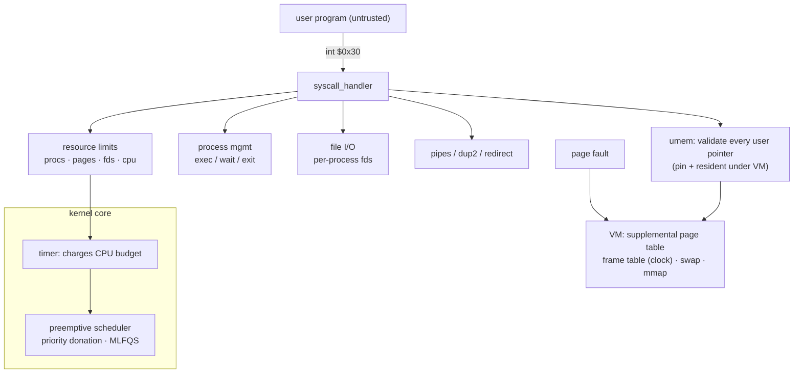
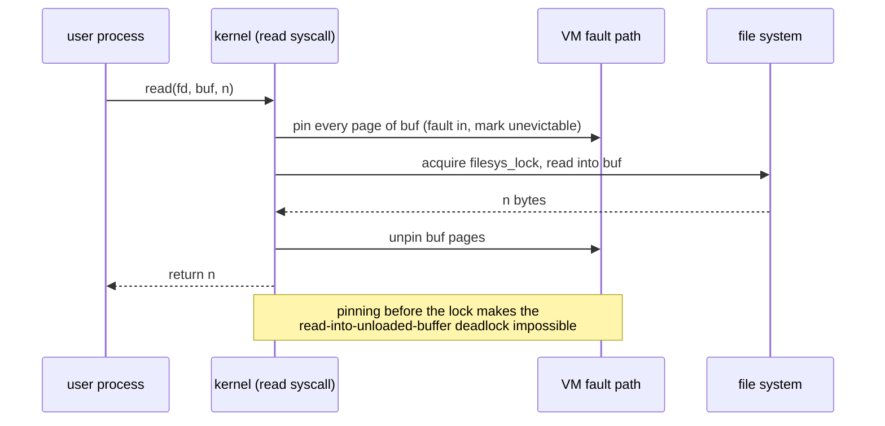

# unix-kernel-subsystem

A Unix-style operating-system kernel built on Stanford's **Pintos** (x86, C): it runs
**many untrusted user programs safely on one machine** — isolating them from the kernel and from
each other, bounding what each may consume, giving them real inter-process communication, and
paging a working set larger than physical RAM to disk. Every capability is backed by tests, and the
page-replacement design is backed by measurements.

**Live benchmark site + demo:** https://sumitparmar19.github.io/unix-kernel-subsystem/ (the page is prebuilt under `docs/`).

> **Origin.** This project builds on Stanford's **Pintos** teaching OS (`pintos-anon` @ `9f013d0`),
> whose license and copyright notices are kept intact under `src/`. The starting point was my
> university coursework (Pintos projects 1–2: scheduling and system calls), preserved unchanged on the
> [`archive/course-submission-2025-11`](../../tree/archive/course-submission-2025-11) branch.
> Everything described below — the user-memory safety work, real IPC (pipes, `dup2`, redirect), the
> "cgroups-lite" resource limits, demand-paged virtual memory, the syscall fuzzer, and the
> eviction-policy benchmarks — I designed and built on top of that base.

---

## What it does

| Capability | What that means here | Evidence |
|---|---|---|
| **System calls** | A POSIX-style syscall layer reached through `int $0x30`; 19 calls (21 with VM: `mmap`, `munmap`) documented against POSIX. | `src/userprog/syscall.c`, [`docs/SYSCALLS.md`](docs/SYSCALLS.md) |
| **Process lifecycle** | `exec`/`wait`/`exit` with a load handshake (exec reports load failure) and parent–child exit-status tracking. | [ADR-002](docs/adr/ADR-002-process-lifecycle.md) |
| **File I/O** | Per-process file descriptors over a global file-system lock. | `src/userprog/ofile.c` |
| **Real IPC** | `pipe` (bounded ring buffer + condition variables), `dup2`, and `exec_redirect` (a `posix_spawn`-style fd redirect) — enough to build a shell with pipelines. | [ADR-005](docs/adr/ADR-005-ipc-pipes.md), `tests/ipc` |
| **Preemptive scheduling** | Priority scheduling with **nested priority donation** and a 4.4BSD-style **MLFQS** (17.14 fixed point). | `src/threads/thread.c` |
| **Pointer safety** | Every user pointer is validated against the process page table before the kernel touches it; under VM it is faulted in, pinned and resident for the whole call. | [ADR-001](docs/adr/ADR-001-user-memory-access.md), `src/userprog/umem.c` |
| **Resource limits ("cgroups-lite")** | Per-subtree process and page caps and per-process fd and CPU-time budgets; a fork bomb is contained, a CPU hog is killed, a good neighbour still meets its deadline. | [ADR-004](docs/adr/ADR-004-resource-limits.md), `tests/limits` |
| **Demand-paged virtual memory** | Supplemental page table, frame table with **clock** eviction, swap, memory-mapped files, lazy loading and stack growth — a working set larger than RAM runs fine. | [ADR-003](docs/adr/ADR-003-virtual-memory.md), `src/vm/` |
| **Observability & measurement** | Kernel stat counters, a syscall fuzzer, event tracing (Perfetto), and a benchmark + simulator comparing eviction policies. | `analysis/benchmarks/`, `scripts/` |

## Test results

Every suite's raw logs are committed under `analysis/test-results/`:

| Suite | Result | Stock Pintos |
|---|---|---|
| `threads` (scheduler, donation, MLFQS) | **27 / 27** | 7 / 27 |
| `userprog` (system calls, process lifecycle) | **80 / 80** | 0 / 80 |
| `ipc` (pipes, dup2, redirect) | **11 / 11** | n/a (new) |
| `vm` (demand paging, swap, mmap) | **113 / 113** | n/a (new) |
| `limits` (resource caps) | **6 / 6** | n/a (new) |
| `hardening` (bug-fix regressions) | **7 / 7** | n/a (new) |

The syscall fuzzer makes ~125k random/boundary calls with **zero kernel panics**; malformed calls
kill only the offending process.

## Measured: which page-replacement policy, and why

The eviction policy is selectable at boot (`-evict=clock|fifo|random`) so it can be measured on the
same workload. At a 4 MB memory budget that forces paging, on `page-parallel`:

| policy | evictions | swap-ins | meaning |
|---|---:|---:|---|
| **clock** (default) | 164 | **3** | second-chance keeps the hot pages |
| random | ~540 | ~360 | evicts by luck |
| fifo | 480 | 320 | evicts hot pages by age; **thrashes the write-heavy workload past the time budget** |

A swap-in is a page the policy evicted and the program needed right back, so clock's 3 vs FIFO's
320 is the whole story. Full tables, charts, a trace-driven simulation against Belady's optimal, and
a one-command reproduction are in **[`analysis/benchmarks/`](analysis/benchmarks/BENCHMARKS.md)**
(prebuilt as a site under `docs/benchmarks/`).

Building that benchmark under parallel stress also **found and fixed two real concurrency bugs** in
the paging path (a free-before-read race in `swap_in`, and a load-during-eviction window) —
[`analysis/benchmarks/BUGS-FOUND.md`](analysis/benchmarks/BUGS-FOUND.md).

## Architecture





Design decisions are recorded as ADRs in [`docs/adr/`](docs/adr/) — written before the code, one per
subsystem.

## How to run

Everything builds and runs in Docker (QEMU inside), so no local toolchain is needed:

```bash
# build the image once
docker build -t pintos-kernel .

# run a full suite (threads | userprog | ipc | vm | limits) -> analysis/test-results/<label>/
scripts/test.sh -l mylabel vm

# run one program by hand
docker run --rm --entrypoint bash -v "$PWD/src:/pintos-src" pintos-kernel -c \
  'cd /pintos-src/vm/build && pintos -v -k --qemu -m 4 --filesys-size=2 --swap-size=4 \
     -p tests/vm/page-parallel -a page-parallel -p tests/vm/child-linear -a child-linear \
     -- -q -f run page-parallel'

# reproduce the eviction benchmark and regenerate the charts
scripts/bench-run.sh
python3 analysis/analyze.py && python3 analysis/simulate.py
```

CI (GitHub Actions) builds the image, runs every suite, and gates on a regression baseline; CodeQL
and cppcheck run on each push.

## Repository map

```
src/            the kernel (threads/ userprog/ vm/ filesys/ + new ipc/ limits/ test suites)
docs/adr/       architecture decision records (one per subsystem, written before the code)
docs/SYSCALLS.md    every system call, its semantics, and its POSIX comparison
docs/benchmarks/    prebuilt GitHub Pages site (eviction measurements + a replayable demo)
analysis/       benchmarks, the eviction simulator, and per-suite test-result logs
scripts/        test / benchmark / fuzz / trace tooling
```

## Credits

Built on Stanford Pintos (`pintos-anon` @ `9f013d0`); its license and copyright notices are kept
intact under `src/`. Pintos projects 1–2 (scheduling and system calls) are my university coursework,
preserved on the [`archive/course-submission-2025-11`](../../tree/archive/course-submission-2025-11)
branch. Everything built on top of that base is described above, with the design rationale recorded
in [`docs/adr/`](docs/adr/), the measurements in
[`analysis/benchmarks/`](analysis/benchmarks/BENCHMARKS.md), and the concurrency bugs found and fixed
in [`analysis/benchmarks/BUGS-FOUND.md`](analysis/benchmarks/BUGS-FOUND.md).
