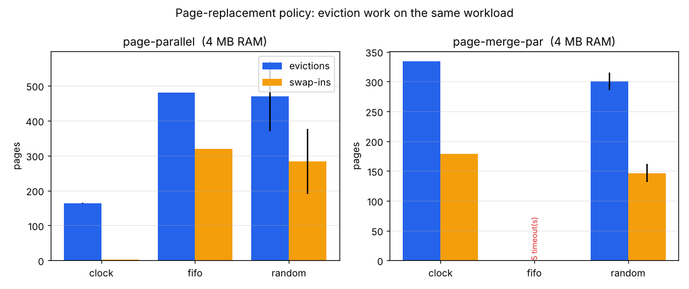
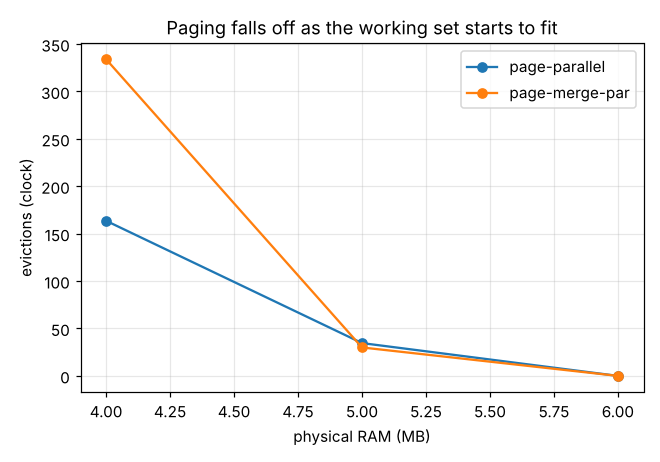

# Page-replacement benchmarks

Generated by `analysis/analyze.py` from `analysis/benchmarks/bench.jsonl`
(`scripts/bench-run.sh`). Each cell is mean±std over **5 seeds**;
counters are the kernel's own `KSTAT` line, `ticks` is Pintos timer ticks
(100 = 1 simulated second). "ok" counts runs that exited 0.

The kernel picks its eviction policy at boot with `-evict=clock|fifo|random`
(`src/vm/frame.c`, ADR-003). `clock` is second-chance (approximates LRU via
the hardware accessed bit); `fifo` evicts the oldest-allocated unpinned
frame; `random` evicts a random unpinned frame.

## Policy comparison at a fixed memory budget (4 MB RAM)

At 4 MB every workload pages heavily, so the policy decides how much I/O the
system does for the *same* program.

| workload | policy | runs | evictions | swap-ins | swap-outs | page-faults | ticks |
|---|---|---|---|---|---|---|---|
| page-merge-par | clock | 10/10 ok | 334 | 179 | 331 | 732 | 283±8 |
| page-merge-par | fifo | 0/5 ok | -- | -- | -- | -- | -- |
| page-merge-par | random | 5/5 ok | 301±15 | 147±15 | 299±15 | 699±15 | 286±13 |
| page-parallel | clock | 10/10 ok | 164±1 | 3 | 159±1 | 1050 | 118±5 |
| page-parallel | fifo | 5/5 ok | 480 | 320 | 479 | 1365 | 179±9 |
| page-parallel | random | 5/5 ok | 470±100 | 284±93 | 462±98 | 1333±95 | 175±23 |



**Reading it.** Fewer evictions and especially fewer **swap-ins** is better: a
swap-in is a page the policy threw out and the program immediately needed
back. On `page-parallel` (sequential scans) clock evicts about 3x fewer pages
than FIFO and, decisively, swaps almost nothing back in (3 vs ~320) because the
accessed bit lets it keep the pages still in use; FIFO blindly evicts by age
and random by luck, so both pay far more swap traffic and run longer (random's
large standard deviation shows how unpredictable luck-based eviction is).

**Where clock does *not* win.** On the write-heavy `page-merge-par`, **random
slightly beats clock** (about 300 evictions / 145 swap-ins vs 334 / 179): a
merge sort rewrites its pages, so almost every frame's accessed bit is set and
clock's second-chance pass degenerates into an extra sweep before it evicts
roughly who FIFO/random would anyway — the bookkeeping is pure cost here. Clock
still wins decisively on the time budget: FIFO exceeds it on **every**
`page-merge-par` run (0/5 finish) and sometimes on `page-parallel` too (its
extra swap traffic makes run time erratic), while clock and random always
finish. The headline is "clock is the safe default," not "clock always has the
fewest evictions"; the "ok" counts above show how many runs of each config
finished within the budget.

## Paging curve: clock vs physical RAM

Holding the policy at clock and growing RAM shows the working set starting to
fit -- eviction work collapses toward zero.

| workload | RAM (MB) | runs | evictions | swap-ins | page-faults |
|---|---|---|---|---|---|
| page-merge-par | 4 | 10/10 ok | 334 | 179 | 732 |
| page-merge-par | 5 | 5/5 ok | 30 | 3 | 556 |
| page-merge-par | 6 | 5/5 ok | 0 | 0 | 550 |
| page-parallel | 4 | 10/10 ok | 164±1 | 3 | 1050 |
| page-parallel | 5 | 5/5 ok | 35±1 | 3 | 1050 |
| page-parallel | 6 | 5/5 ok | 0 | 0 | 1044 |



At 6 MB `page-parallel` and `page-merge-par` both reach **0 evictions**: the
whole working set is resident. Running this curve originally exposed two
concurrency bugs in the paging code (a free-before-read race in `swap_in` and
a load-during-eviction window) that only the benchmark's parallel stress
triggered; both are now fixed and every memory size passes. The diagnosis and
fixes are written up in `analysis/benchmarks/BUGS-FOUND.md`.

## How to reproduce

```bash
scripts/bench-run.sh            # writes analysis/benchmarks/bench.jsonl
python3 analysis/analyze.py     # regenerates this file + the PNGs
```
